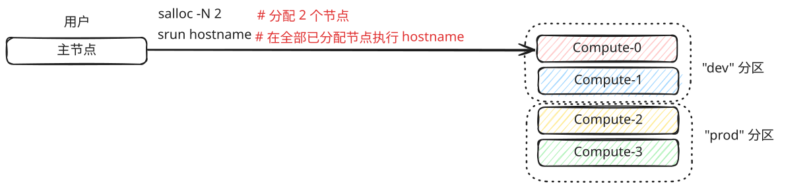
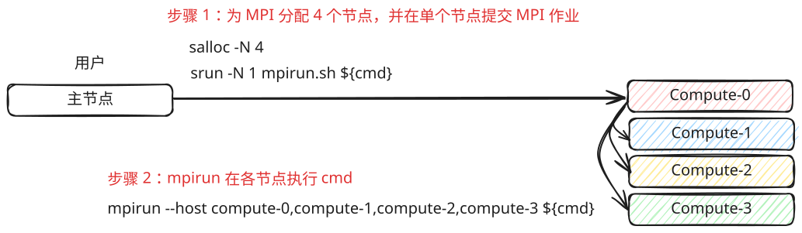

.. meta::
    :description lang=zh_CN: Slurm HPC 作业调度、批处理作业、分布式训练、MPI、Enroot 容器和集群管理命令的速查表
    :keywords: Slurm, HPC, job scheduler, sbatch, srun, salloc, distributed training, MPI, Enroot, Pyxis, cluster computing, workload manager, GPU cluster, machine learning, PyTorch distributed

==============================
Slurm 调度（Slurm）
==============================

.. contents:: 目录（Table of Contents）
    :backlinks: none

Slurm（Simple Linux Utility for Resource Management）是一个广泛应用于高性能计算（HPC）集群的开源作业调度和工作负载管理系统。它旨在高效分配资源、管理 queues 以及跨大量计算节点调度作业。 Slurm 是 HPC 作业调度的事实上的标准，为许多世界上最大的超级计算机和用于科学计算、机器学习和 AI 研究的 GPU 集群提供支持。

对于机器学习工程师来说，Slurm 提供了一种简单的方法来为大型语言模型 (LLM) 和跨多个节点分片的深度学习工作负载启动分布式训练作业。与 Kubernetes 等容器编排系统不同（通常需要额外的组件，例如用于 ML 工作负载调度的 Kubeflow），Slurm 提供了更简单、以 HPC 为中心的工作流程。用户可以通过 ``srun`` 、 ``sbatch`` 、 ``squeue`` 等命令直接提交和管理作业，无需配置complex编排层。

本速查表涵盖了基本的 Slurm 命令和工作流程，用于提交作业、管理资源、使用 PyTorch 运行分布式训练、启动 MPI 应用程序以及使用 Enroot 和 Pyxis 容器。

Slurm 信息（Slurm Info）
----------------------------------------

``sinfo`` 是用于显示有关 Slurm 管理的集群的一般信息的命令，例如可用节点和分区的数量。它还允许用户检查节点的状态，包括识别已关闭或处于错误状态的节点。

.. code-block:: bash

    # 显示 slurm 一般信息
    sinfo

    # 显示分区信息
    sinfo -s
    sinfo --summarize

    # 显示分区信息
    PARTITION=dev
    sinfo -p ${PARTITION}

    # 显示空闲状态的节点
    sinfo --state=idle

    # 以特定格式显示节点
    sinfo -o "%n %P %t %C"  # 节点、分区、状态、CPU

    # 显示 GPU 信息（如果配置）
    sinfo -o "%n %G"

节点信息（Node Info）
------------------------------

``scontrol show node`` 提供有关集群中特定节点的详细信息，包括 CPU 计数、内存、GPU 资源和当前状态。这对于 debugging 节点问题或验证硬件配置非常有用。

.. code-block:: bash

    # 显示所有节点信息
    scontrol show nodes

    # 显示特定节点信息
    scontrol show node compute-01

    # 以可解析格式显示节点
    scontrol show node compute-01 --oneliner

    # list 所有主机名
    scontrol show hostnames

    # 将节点 range 扩展为 list
    scontrol show hostnames compute-[0-5]

    # 显示空闲状态的节点
    sinfo --state=idle

提交作业（Submit Jobs）
----------------------------------

使用 ``srun`` 在前台跨多个节点启动作业非常简单。例如，运行 ``srun hostname`` 将在多个分配的节点上执行 ``hostname`` 命令，并等待所有节点返回结果。通过 ``srun`` ，用户可以轻松指定：

* 运行作业的节点数 ( ``--nodes`` )
* 将作业提交到的分区或 queue ( ``--partition`` )
* 作业的时间限制（ ``--time`` ），确保作业完成或达到其时间限制时自动释放计算资源

默认情况下， ``srun`` 在前台交互运行，非常适合快速测试或 debugging。对于较长或批处理作业，用户通常将 srun 与通过 ``sbatch`` 提交的作业脚本配对。

.. code-block:: bash

    # 向计算节点提交作业
    srun -N1 hostname

    # 在特定节点上提交作业
    srun --nodelist=compute-[0-5] hostname

    # 将作业提交到特定分区
    PARTITION=dev
    srun -p ${PARTITION} --nodelist=compute-[0-5] hostname

    # 在2个节点上通过srun提交作业（使用dd模拟高CPU消耗作业）
    srun -N2 dd if=/dev/zero of=/dev/null

    # 提交有时间限制的作业。
    # - 分钟
    # - 分钟：秒
    # - 小时:分钟:秒
    # - 天-小时
    # - 天-小时:分钟
    # - 天-小时:分钟:秒
    #
    # 例如：以下作业将在 1 分 30 秒后超时
    srun -N2 --time=01:30 dd if=/dev/zero of=/dev/null

    # 登录节点
    srun -N 1 --pty /bin/bash

分配节点（Alloc Nodes）
----------------------------------

在某些场景中，用户可能需要对特定节点进行独占、交互式访问以进行实验或测试。对于 instance，运行基准测试的研究人员可能要求所有基准测试在相同的固定节点上执行，以确保结果的一致性和可重复性。 salloc命令用于交互地请求和分配资源。通过使用 ``salloc`` ，用户可以预留特定数量的节点，确保实验期间不会在其上调度其他作业。这种隔离有助于避免可能影响基准测试或性能测量的资源争用。例如，以下命令为交互式会话分配 2 个节点：

.. code-block:: bash

    # 分配 2 个节点并在这些分配的节点上提交作业
    salloc -N 2
    srun hostname
    exit # 释放分配的节点

    # 在特定分区上分配节点
    PARTITION=dev
    salloc -N 2 -p ${PARTITION}

.. note::

    ``salloc`` 特别适用于：

    * 互动debugging
    * 基准测试和性能测试
    * 无需编写完整的作业脚本即可运行探索性工作负载

取消作业（Cancel Jobs）
----------------------------------

用户有时可能会因为各种原因需要取消他们的工作。例如，集群管理员可能会宣布维护（例如升级系统libraries），要求用户终止正在运行的作业。在其他情况下，作业可能会挂起或消耗不必要的计算资源，从而需要取消作业。 Slurm 提供 ``scancel`` 命令来干净地终止作业。用法示例：

.. code-block:: bash

    # 取消工作
    scancel "${jobid}"

    # 取消作业并禁用警告
    scancel -q "${jobid}"

    # 取消属于某个帐户的所有作业
    scancel --account="${account}"

    # 取消属于某个分区的所有作业
    scancel --partition="${partition}"

    # 取消所有待处理的作业
    scancel --state="PENDING"

    # 取消所有正在运行的作业
    scancel --state="RUNNING"

    # 取消所有作业
    squeue -l | awk '{ print $ 1}' | grep '[[:digit:]].*' | xargs scancel

    # 取消所有作业（使用状态选项）
    for s in "RUNNING" "PENDING" "SUSPAND"; do scancel --state="$s"; done

提交批量作业（Submit Batch Jobs）
--------------------------------------------------

``sbatch`` 是 Slurm 命令，用于提交批处理作业以在集群上执行。与通常在前台交互式运行作业的 ``srun`` 不同， ``sbatch`` 专为在后台运行长时间的非交互式工作负载而设计。这允许用户提交作业，而无需维护到集群头节点的活动 SSH 会话，使其成为大规模或耗时任务的理想选择。

典型的工作流程包括编写 Slurm 作业脚本，其中包含作业规范（例如节点数量、时间限制和分区）以及一个或多个用于执行程序的 srun 命令。使用 sbatch queues 提交此脚本作业，Slurm 会根据可用资源自动调度它。示例批处理脚本：

.. code-block:: bash

    #!/bin/bash
    #SBATCH --nodelist=compute-[0-1]
    #SBATCH --output=logs/%x_%j.out
    #SBATCH --error=logs/%x_%j.out
    #SBATCH --ntasks-per-node=8

    master_addr="$(scontrol show hostnames | sort | head -n 1)"
    srun hostname
    srun torchrun \
      --nproc-per-node="$SLURM_NPROCS" \
      --nnodes="$SLURM_NNODES"
      --master-addr="${master_addr}" \
      --master-port=29500 \
      ${PWD}/train.py

    # sbatch job.sh

提交 mpirun（Submit mpirun）
------------------------------------------------

在某些 HPC 环境中，由于安全限制、最少的软件安装或限制登录节点繁重工作负载的站点策略，用户可能无法直接在头（登录）节点上加载 MPI module。在这种情况下，工作流程是使用 Slurm 分配计算节点并从这些节点之一启动 ``mpirun`` 。从那里，mpirun 协调 MPI 程序在所有分配的节点上的执行。

.. code-block:: bash

    #!/bin/bash

    # 用法：
    #
    # rank_per_node=8
    # salloc -N 4
    # ./mpirun.sh ${rank_per_node} ${二进制}

    launch() {
      local rank_per_node="${1}"
      local args=("${@:2}")
      local arr
      local hosts
      local cmd

      mapfile -t arr < <(scontrol show hostnames | sort)
      OLDIFS="${IFS}"
      IFS=","
      hosts="${arr[*]}"
      IFS="${OLDIFS}"

      cmd="$(cat <<EOF

      mpirun \
      -N "${rank_per_node}" \
      --allow-run-as-root \
      --host "${hosts}" \
      --mca pml ^cm --mca plm_rsh_no_tree_spawn 1 \
      --mca btl_tcp_if_exclude lo,docker0,veth_def_agent \
      --mca plm_rsh_num_concurrent "${#arr[@]}" \
      --mca btl_vader_single_copy_mechanism none \
      --oversubscribe \
      --tag-output \
      ${args[@]}

    EOF
    )"

      # 将 mpirun 作业提交到单个节点，因为 mpirun 将在以下节点上启动作业
      # 其他节点。因此，使用srun时需要指定-N 1。
      srun -N 1 bash -c "${cmd}"
    }

    launch "$@"

使用 Enroot 提交作业（Submit Jobs with Enroot）
------------------------------------------------------------------------------

有时，用户需要运行具有不同于集群系统范围环境的自定义依赖项的作业。例如，如果集群配置为 NCCL 2.23，但用户想要 benchmark NCCL 2.27，则要求管理员为单个实验升级或修改系统 libraries 通常是不切实际的。一种解决方法是创建具有所需依赖项的自定义容器（e.g.、Docker 映像），并从该环境启动作业。然而，由于 namespace 隔离和安全限制，在 HPC 环境中运行容器通常需要额外的设置和特殊标志。

为了简化这个 process， `Enroot <https://github.com/NVIDIA/enroot>`_ 提供了传统容器运行时的轻量级替代方案。它允许用户在 HPC 设置中以最小的开销运行隔离文件系统，类似于 ``chroot`` ，同时仍然授予对系统硬件（e.g、GPU、互连）的直接访问权限。这使其成为需要微调性能的 ML 和 HPC 工作流程的理想选择。

`Pyxis <https://github.com/NVIDIA/pyxis>`_ 构建于 Enroot 之上，是一个 Slurm 插件，可以在 Enroot 容器内启动作业，而无需编写额外的包装器脚本。用户可以直接在 sbatch 或 srun 命令中指定 Enroot 压缩文件和运行时选项，将容器工作流程无缝集成到 Slurm 作业提交中。以下代码片段显示了通过 Enroot 和 Pyxis 启动作业的几种方法。

.. code-block:: bash

   # 构建 enroot sqsh 文件
   $ enroot import -o "${output_sqsh}" "dockerd://${image}"

   # 使用 enroot 提交作业
   srun --container-image "${output_sqsh}" \
     --container-mounts "/fsx:/fsx,/nfs:/nfs" \
     --ntasks-per-node=8 \
     ${cmd}

   # 使用 enroot 提交 mpi 作业
   srun --container-image "${output_sqsh}" \
     --container-mounts "/fsx:/fsx,/nfs:/nfs" \
     --ntasks-per-node=8 \
     --mpi=pmix \
     ${cmd}

作业状态（Job Status）
--------------------------------

要监视 Slurm 管理的集群中作业的状态，用户可以使用 ``squeue`` 命令。该工具显示有关已提交作业的基本详细信息，例如作业 ID、作业名称、分区、分配的节点和作业状态。常见的工作状态包括：

* RUNNING – 作业正在分配的资源上主动运行。
* PENDING – 作业正在 queue 中等待资源可用。
* FAILED – 作业由于错误或不满足条件而失败。

如果作业卡住、失败或行为异常，您可以使用 ``scancel`` 命令终止它，并在修复问题后重新提交。

.. code-block:: bash

   # 检查所有 Slurm 作业状态
   squeue

   # 检查用户的工作状态
   squeue --user=${USER}

资源预留（Reservation）
----------------------------------

从管理员的角度来看，可能需要保留特定节点以防止 Slurm 在其上调度作业。例如，应保留遇到硬件或软件问题（例如网络故障或磁盘错误）的节点，以避免作业失败。预留节点允许管理员排除故障、修复或执行维护，而不会干扰活动工作负载。以下代码片段演示了如何通过 ``scontrol`` 为节点创建预留并检查其预留状态。

.. code-block:: bash

    # 预留节点供用户测试
    # - 分钟
    # - 分钟：秒
    # - 小时:分钟:秒
    # - 天-小时
    # - 天-小时:分钟
    # - 天-小时:分钟:秒
    #
    # ex：预留所有节点120m用于维护
    scontrol create reservation ReservationName=maintenance \
        starttime=now duration=120 user=root flags=maint,ignore_jobs nodes=ALL

    # 必须注明预订；否则，作业将不会运行
    srun --reservation=maintain ping 8.8.8.8 2>&1 > /dev/null

    # 显示预订
    scontrol show res

    # 删除预订
    scontrol delete ReservationName=maintain

    # drain nodes for maintenance. ex: nodes=compute-[01-02],compute-08
    scontrol update NodeName=compute-[01-02],compute-08 State=DOWN Reason=”maintenance”

    # 恢复节点
    scontrol update NodeName=compute-[01-02],compute-08 State=Resume

用量统计（Accounting）
--------------------------------

Slurm 包括功能强大的会计和资源管理系统，允许管理员控制计算资源的分配方式并确保所有用户的公平使用。通过该系统，管理员可以配置公平共享调度、作业优先级策略和资源限制，以防止单个用户或组长时间独占集群资源。

通过 ``fairshare`` ，Slurm 根据历史资源使用情况动态调整作业优先级，确保消耗较少资源的用户在作业 queue 中获得更高的优先级，而大量用户可能会遇到较低的优先级，直到使用平衡。这有助于维持多用户 HPC 环境中的公平访问。管理员通过 Slurm 的数据库支持的会计系统 ( ``slurmdbd`` ) 和以下命令来管理这些策略：

.. code-block:: bash

    # 创建集群（集群名称应与slurm.conf中的ClusterName相同）
    sacctmgr add cluster clustername

    # 创建一个帐户
    sacctmgr -i add account worker description="worker account" Organization="your.org"

    # 创建用户并添加到帐户
    sacctmgr create user name=worker DefaultAccount=default

    # 创建用户并添加到其他帐户
    sacctmgr -i create user "worker" account="worker" adminlevel="None"

    # 修改用户fairshare配置
    sacctmgr modify user where name="worker" account="worker" set fairshare=0

    # 从帐户中删除用户
    sacctmgr remove user "worker" where account="worker"

    # 显示所有用户
    sacctmgr show account

    # 显示所有有关联的用户
    sacctmgr show account -s

作业历史（Job History）
----------------------------------

``sacct`` 显示已完成和正在运行的作业的会计数据。这对于分析作业性能、debugging 失败的作业以及跟踪一段时间内的资源使用情况至关重要。与仅显示活动作业的 ``squeue`` 不同， ``sacct`` 可以从 Slurm 会计数据库检索历史作业信息。

.. code-block:: bash

    # 显示当前用户最近的工作
    sacct

    # 显示特定日期 range 的职位
    sacct --starttime=2024-01-01 --endtime=2024-01-31

    # 显示具体的工作详细信息
    sacct -j ${jobid} --format=JobID,JobName,Partition,State,ExitCode,Elapsed

    # 显示详细的资源使用情况
    sacct -j ${jobid} --format=JobID,MaxRSS,MaxVMSize,AveRSS,AveCPU

    # 显示所有字段
    sacct -j ${jobid} --format=ALL

    # 显示特定状态的职位
    sacct --state=FAILED --starttime=2024-01-01

    # debugging 的通用格式
    sacct -j ${jobid} --format=JobID,JobName,State,ExitCode,DerivedExitCode,Comment

环境变量（Environment Variables）
------------------------------------------------------

Slurm sets 作业运行时的各种环境 variables，提供有关作业的分配和配置的信息。这些 variables 对于编写适应不同资源分配的可移植作业脚本至关重要。

.. code-block:: bash

    # 常见 Slurm 环境 variables
    echo $SLURM_JOB_ID          # 职位 ID
    echo $SLURM_JOB_NAME        # 职位名称
    echo $SLURM_JOB_NODELIST    # 分配节点数List
    echo $SLURM_JOB_NUM_NODES   # 分配的节点数
    echo $SLURM_NNODES          # 与SLURM_JOB_NUM_NODES相同
    echo $SLURM_NTASKS          # 任务总数
    echo $SLURM_NTASKS_PER_NODE # 每个节点的任务
    echo $SLURM_CPUS_PER_TASK   # 每个任务的 CPU 数
    echo $SLURM_PROCID          # MPI 排名（全球）
    echo $SLURM_LOCALID         # 节点上的本地任务 ID
    echo $SLURM_NODEID          # 分配中的节点 ID
    echo $SLURM_SUBMIT_DIR      # 提交作业的目录
    echo $SLURM_GPUS            # GPU 数量（如果已分配）
    echo $SLURM_GPUS_PER_NODE   # GPUs per node

GPU 作业（GPU Jobs）
--------------------------------

对于机器学习和深度学习工作负载，请求 GPU 资源至关重要。 Slurm 通过通用资源 (GRES) 插件支持 GPU 调度。用户可以请求特定数量的 GPU、GPU types 或每个任务的 GPU。

.. code-block:: bash

    # 请求 1 GPU
    srun --gres=gpu:1 nvidia-smi

    # 请求 4 个 GPU
    srun --gres=gpu:4 python train.py

    # 请求特定的 GPU type（如果已配置）
    srun --gres=gpu:a100:2 python train.py

    # 每个任务请求 GPU
    srun --ntasks=4 --gres=gpu:4 --gpus-per-task=1 python train.py

    # sbatch example with GPUs
    #!/bin/bash
    #SBATCH --nodes=2
    #SBATCH --ntasks-per-node=8
    #SBATCH --gres=gpu:8
    #SBATCH --cpus-per-task=12

    srun python train.py

PyTorch 分布式训练（PyTorch Distributed Training）
--------------------------------------------------------------------------------------

在 Slurm 上启动分布式 PyTorch 训练作业需要跨节点协调多个 processes。 ``torchrun`` 启动器通过处理 process 生成和环境设置来简化这一过程。这是多节点分布式训练的完整示例。

.. code-block:: bash

    #!/bin/bash
    #SBATCH --job-name=distributed-train
    #SBATCH --nodes=4
    #SBATCH --ntasks-per-node=1
    #SBATCH --gpus-per-node=8
    #SBATCH --cpus-per-task=96
    #SBATCH --output=logs/%x_%j.out
    #SBATCH --error=logs/%x_%j.err

    # 获取主节点地址
    MASTER_ADDR=$(scontrol show hostnames $SLURM_JOB_NODELIST | head -n 1)
    MASTER_PORT=29500

    # Set 用于分布式训练的环境 variables
    export NCCL_DEBUG=INFO
    export NCCL_IB_DISABLE=0
    export NCCL_NET_GDR_LEVEL=2

    srun torchrun \
        --nnodes=$SLURM_NNODES \
        --nproc_per_node=8 \
        --rdzv_id=$SLURM_JOB_ID \
        --rdzv_backend=c10d \
        --rdzv_endpoint=$MASTER_ADDR:$MASTER_PORT \
        train.py --batch-size=32 --epochs=100

对于使用 Enroot 和 Pyxis 的容器化环境，添加 ``--container-image`` 以在具有特定 CUDA、PyTorch 或 NCCL 版本的自定义容器内运行训练。使用 ``--container-env`` 将环境 variables 传递到容器中：

.. code-block:: bash

    #!/bin/bash
    #SBATCH --job-name=distributed-train
    #SBATCH --nodes=4
    #SBATCH --ntasks-per-node=1
    #SBATCH --gpus-per-node=8
    #SBATCH --cpus-per-task=96
    #SBATCH --output=logs/%x_%j.out

    MASTER_ADDR=$(scontrol show hostnames $SLURM_JOB_NODELIST | head -n 1)
    MASTER_PORT=29500

    srun --container-image=/path/to/pytorch-24.01.sqsh \
         --container-mounts="/data:/data,${PWD}:/workspace" \
         --container-workdir=/workspace \
         --container-env="NCCL_DEBUG=INFO,NCCL_IB_DISABLE=0,NCCL_NET_GDR_LEVEL=2" \
         torchrun \
            --nnodes=$SLURM_NNODES \
            --nproc_per_node=8 \
            --rdzv_id=$SLURM_JOB_ID \
            --rdzv_backend=c10d \
            --rdzv_endpoint=$MASTER_ADDR:$MASTER_PORT \
            train.py --batch-size=32 --epochs=100

阵列作业（Array Jobs）
--------------------------------

Array 作业允许使用单个 ``sbatch`` 命令提交多个相似的作业。 array 中的每个作业都与唯一的 ``SLURM_ARRAY_TASK_ID`` 独立运行，使其成为 parameter 扫描、超参数调整或处理多个数据集的理想选择。

.. code-block:: bash

    #!/bin/bash
    #SBATCH --job-name=array-job
    #SBATCH --array=0-9
    #SBATCH --output=logs/array_%A_%a.out

    # SLURM_ARRAY_JOB_ID - 作业 array 的主作业 ID
    # SLURM_ARRAY_TASK_ID - 作业 array index（本例中为 0-9）

    echo "Array task ID: $SLURM_ARRAY_TASK_ID"
    python train.py --seed=$SLURM_ARRAY_TASK_ID

    # 提交 array 作业
    # sbatch array_job.sh

    # 以步长 (0, 2, 4, 6, 8) 提交
    #SBATCH --array=0-9:2

    # 以最大并发任务提交
    #SBATCH --array=0-99%10  # max 10 running at once

    # 取消特定的 array 任务
    scancel ${jobid}_5      # 取消任务5
    scancel ${jobid}_[1-3]  # cancel tasks 1-3

作业依赖（Job Dependencies）
--------------------------------------------

作业依赖关系允许您控制作业的执行顺序。一个作业可以等待另一个作业完成、成功或失败后再开始。这对于创建必须在训练之前完成预处理的管道非常有用。

.. code-block:: bash

    # 提交第一份工作
    JOB1=$(sbatch --parsable preprocess.sh)

    # 第一个作业成功完成后提交第二个作业
    JOB2=$(sbatch --parsable --dependency=afterok:$JOB1 train.sh)

    # 第二个作业完成后提交第三个作业（无论状态如何）
    sbatch --dependency=afterany:$JOB2 postprocess.sh

    # 依赖项 types：
    # after:jobid - 作业开始后开始
    # afterok:jobid - 作业成功完成后启动
    # afternotok:jobid - 作业失败后启动
    # afterany:jobid - 作业完成后开始（任何状态）
    # 单例 - 一次仅运行一项同名作业

    # 多重依赖
    sbatch --dependency=afterok:$JOB1:$JOB2 final.sh

资源限制（Resource Limits）
------------------------------------------

设置适当的资源限制有助于确保公平的集群使用并防止作业消耗过多的资源。 Slurm 允许指定每个作业的内存、CPU 和时间限制。

.. code-block:: bash

    # 每个节点的内存
    srun --mem=64G python train.py

    # 每个 CPU 的内存
    srun --mem-per-cpu=4G python train.py

    # CPU 极限
    srun --cpus-per-task=8 python train.py

    # 时间限制（如果超过则终止工作）
    srun --time=24:00:00 python train.py

    # 独占节点访问（不共享）
    srun --exclusive python train.py

    # sbatch example with limits
    #!/bin/bash
    #SBATCH --mem=128G
    #SBATCH --cpus-per-task=32
    #SBATCH --time=48:00:00
    #SBATCH --exclusive

调试失败的作业（Debugging Failed Jobs）
------------------------------------------------------------

当作业失败时，Slurm 提供了多种工具来诊断问题。常见问题包括内存不足错误、超出时间限制和节点故障。

.. code-block:: bash

    # 检查作业 exit code 和状态
    sacct -j ${jobid} --format=JobID,State,ExitCode,DerivedExitCode

    # 常见exit codes：
    # 0 - 成功
    # 1 - 一般错误
    # 137 - OOM 被杀（128 + 9 SIGKILL）
    # 143 - 时间限制 (128 + 15 SIGTERM)

    # 检查作业的 stderr/stdout
    cat slurm-${jobid}.out

    # 检查作业为何待处理
    squeue -j ${jobid} --format="%i %r"

    # 常见待处理原因：
    # 资源 - 等待资源
    # 优先级 - 优先级低于其他作业
    # 依赖 - 等待依赖作业
    # QOSMaxJobsPerUserLimit - 达到用户作业限制

    # 显示详细的职位信息
    scontrol show job ${jobid}

    # 检查运行作业的节点运行状况
    scontrol show node ${nodename}
